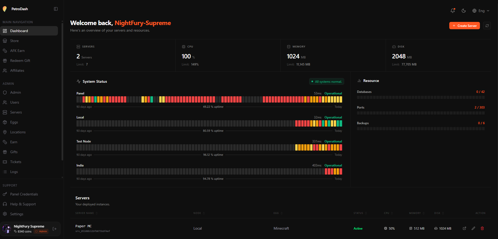

# PetroDash - Pterodactyl Control Panel & Client Dashboard

[](https://www.bestpractices.dev/projects/13986)
[](LICENSE)
[](https://nextjs.org/)
[](https://nodejs.org/)
[](https://www.docker.com/)

A powerful, open-source dashboard and client management panel for Pterodactyl servers with multi-language support. Create and manage game servers, scale resources (CPU, RAM, Disk, Ports), earn coins with AFK & Linkvertise, accept PayPal payments with automatic PDF invoices, display Google AdSense ads, manage support tickets, send transactional emails, and configure your entire community with a comprehensive administrator suite.


---

## ⚡ Install

Copy and paste this single command into your server terminal as `root` (or with `sudo`):

```bash
bash <(curl -s https://raw.githubusercontent.com/NightFury-Supreme/PetroDash/main/pterodash.sh)
```

The installer automatically sets up Docker, creates your database and secure environment, configures host Nginx, sets up SSL certificates (Let's Encrypt or Self-Signed), and creates your Administrator account.

### 💡 Manage PteroDash Anytime
Once installed, simply type `pterodash` anywhere in your terminal to access the management suite:

```bash
pterodash
```

> For full deployment details, SSL management, and Nginx customization, see the [Installation Guide](INSTALL.md).

---

## 📸 Dashboard Preview



---

## 🚀 Key Features

### 🖥️ Server & Resource Management
- **One-Click Server Deployment**: Deploy game servers using custom eggs and location allocations connected directly to your Pterodactyl panel.
- **Resource Scaling**: Allocate and scale CPU, RAM, Disk, Backups, Databases, and Network Allocations / Ports.
- **Live Status & Metrics**: Monitor node ping latency, panel connectivity, and resource usage in real time.
- **Server Modification & Refunds**: Edit server resources on the fly or delete instances with automated resource reclamation.

### 🛡️ Authentication & User Security
- **Modern Authentication**: Secure email and password authentication with email verification.
- **OAuth Social Login**: One-click sign-in via Discord and Google OAuth 2.0.
- **Two-Factor Authentication (2FA)**: Time-based One-Time Password (TOTP) support with QR code enrollment and backup codes.
- **Session & Device Manager**: View active sessions, IP locations, user agents, and remotely revoke sessions.
- **Activity Logging**: Account history log tracking logins, password updates, and security events.

### 💰 Coin Economy & Reward Systems
- **AFK Coin Earning**: Earn coins automatically in the background while keeping the dashboard open.
- **Linkvertise Integration**: Complete link tasks to earn coins through configured shortlinks.
- **Gift Codes**: Redeem coin vouchers or generate gift codes to share coins with other users.
- **Referral System**: Share unique referral codes to invite friends and receive commission rewards.

### 🛒 Store, Plans & PayPal Payments
- **Resource Shop**: Purchase individual RAM, CPU, Disk, server slots, ports, and databases using coins.
- **Server Plans**: Choose pre-configured server packages with dedicated resource quotas.
- **Discount Coupons**: Apply promo codes at checkout for percentage or flat-rate discounts.
- **PayPal Integration**: Native PayPal checkout with automated webhook fulfillment.
- **PDF Invoices**: Downloadable, formatted PDF billing invoices with order and transaction details.

### 📢 Google AdSense & Monetization
- **AdSense Integration**: Built-in Google AdSense banner placements across dashboard views.
- **AdBlocker Detection**: Configurable adblock detector modal encouraging users to support your platform.

### 📬 Automated Email System
- **Transactional SMTP Emails**: Send notifications for registrations, password resets, and ticket activity.
- **Branded HTML Templates**: Responsive email templates for account verification, password changes, security login alerts, ban notifications, and support replies.

### 🎫 Support Ticket Helpdesk
- **Department Routing**: Categorize tickets by technical support, billing, or general inquiries with priority flags.
- **Live Agent Messaging**: Real-time message streaming with user mentions (`@user`), staff badges, and file attachments.
- **Ticket Lifecycle**: Track tickets through Open, In Progress, Resolved, and Closed states.

### 👑 Comprehensive Administrator Suite
- **Admin Dashboard**: Overview of system metrics, active users, total servers, and node health.
- **User Management**: Search, filter, edit coin balances, modify passwords, inspect user servers, and issue instant or timed bans.
- **Server Manager**: Inspect all deployed servers across nodes, change ownership, update allocations, or delete instances.
- **Egg & Location Manager**: Group eggs into custom categories, configure startup variables, and upload custom egg icons and country flags.
- **Coupons & Gift Manager**: Generate and manage promotional discount coupons and coin reward gift codes.
- **AFK & Earn Settings**: Configure coin drop intervals, earn rates, and anti-abuse parameters.
- **Platform Settings**: Customize website branding, logo, favicon, SEO meta tags, AdSense client IDs, PayPal credentials, SMTP mail, and Pterodactyl API settings.
- **Audit Logs**: Immutable log recording every administrative action, IP address, and timestamp.

### 🌐 Modern UI & Internationalization
- **Clean Dark Theme**: Custom dark user interface with card styling and smooth animations.
- **Sliding Progress Loader**: Brand-orange Google Material indeterminate loading progress bar.
- **Multi-Language Support**: Complete internationalization powered by `next-intl` (English, German, French, Spanish, Russian, Portuguese, etc.).

---

## 🏗️ Technology Stack

| Layer | Technologies |
| :--- | :--- |
| **Frontend** | [Next.js 16](https://nextjs.org/) (App Router), [React 19](https://react.dev/), [Tailwind CSS](https://tailwindcss.com/), [Lucide React](https://lucide.dev/), [next-intl](https://next-intl-docs.vercel.app/) |
| **Backend** | [Node.js 20 LTS](https://nodejs.org/), [Express](https://expressjs.com/), [Mongoose / MongoDB](https://www.mongodb.com/), [IORedis / Redis](https://redis.io/) |
| **Security & Utilities** | [JWT](https://jwt.io/), [OTPLib](https://github.com/yeojinj/otplib), [Helmet](https://helmetjs.github.io/), [Express Rate Limit](https://express-rate-limit.mintlify.app/), [PDFKit](https://pdfkit.org/) |
| **Deployment** | [Docker](https://www.docker.com/), [Docker Compose](https://docs.docker.com/compose/), [Nginx](https://nginx.org/), [Certbot](https://certbot.eff.org/) |

---

## ⚙️ Configuration & Environment

PteroDash includes pre-configured environment templates:

- [`.env.example`](.env.example): Root template used by Docker Compose and `pterodash.sh`.
- [`backend/.env.example`](backend/.env.example): Standalone backend configuration.
- [`frontend/.env.example`](frontend/.env.example): Standalone frontend configuration.

---

## 🤝 Contributing

Contributions, issues, and feature requests are welcome!
Feel free to check the [issues page](https://github.com/NightFury-Supreme/PetroDash/issues) or submit a pull request.

---

## 📝 License

Distributed under the **MIT License**. See [`LICENSE`](LICENSE) for more information.

---

## 💬 Community & Support

- **Discord Server**: [Join our Discord](https://discord.gg/vQzbuQD7Xp)
- **Documentation**: [Installation Guide](INSTALL.md) • [Changelog](CHANGELOG.md)
- **Bug Reports**: [GitHub Issues](https://github.com/NightFury-Supreme/PetroDash/issues)

---

<p align="center">Made with ❤️ for the game server hosting community.</p>
